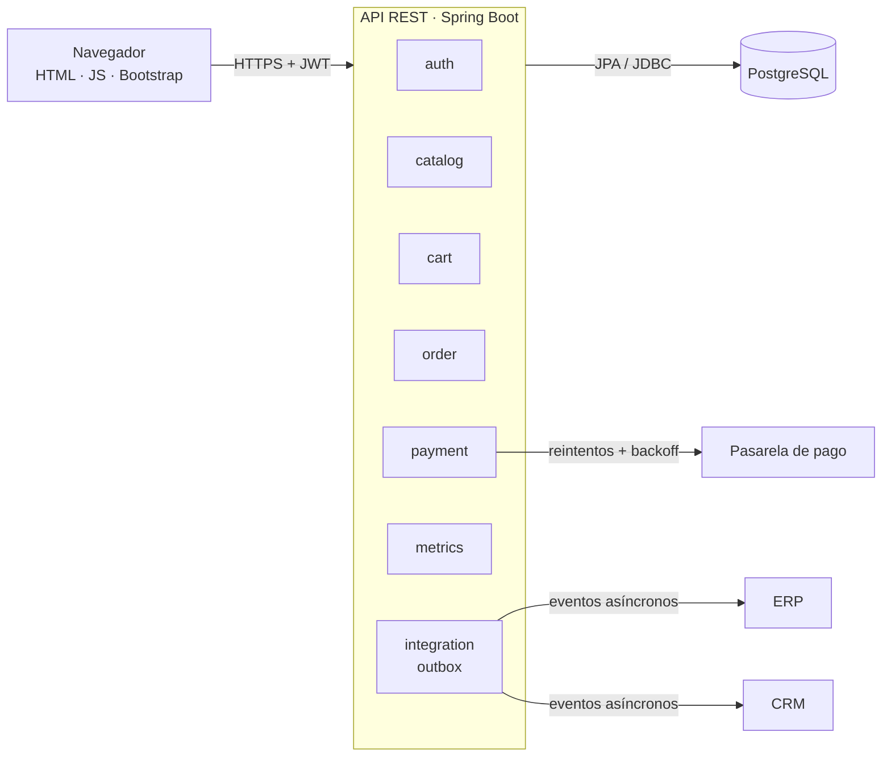
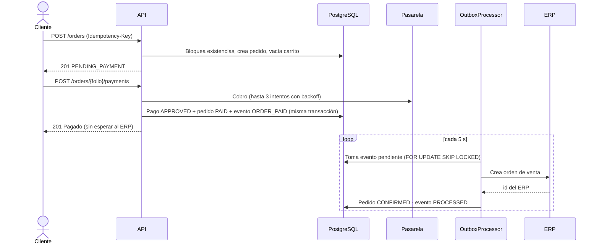
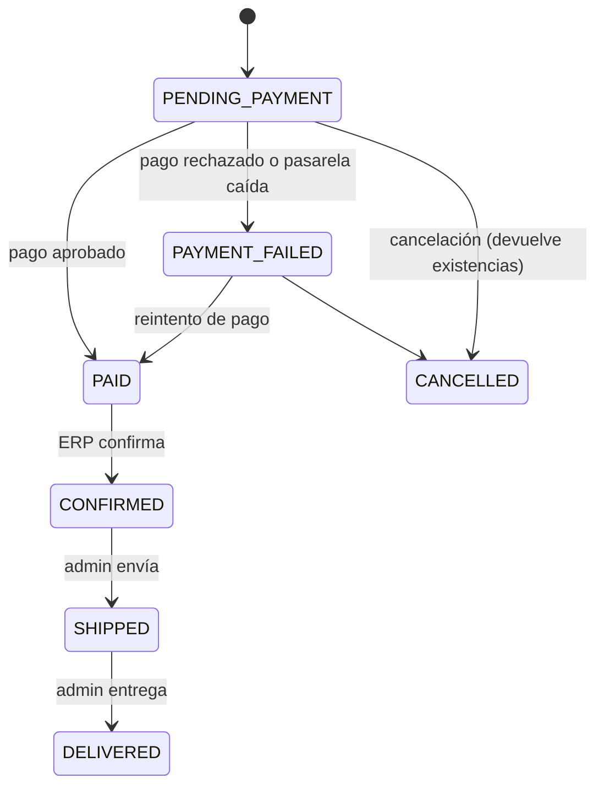

# B2B Marketplace API

MVP de **eCommerce B2B** para que distribuidores y clientes autorizados realicen pedidos, con
**integración a ERP y CRM**, pagos con una pasarela de errores intermitentes y un panel de
indicadores de negocio. Incluye un front ligero en HTML5, CSS3, JavaScript y Bootstrap.

> Proyecto desarrollado como respuesta al caso de uso **"Desarrollo de un eCommerce B2B"**.

---

## Contenido

1. [Funcionalidades](#funcionalidades)
2. [Stack tecnológico](#stack-tecnológico)
3. [Ejecución rápida con Docker](#ejecución-rápida-con-docker)
4. [Ejecución local (desarrollo)](#ejecución-local-desarrollo)
5. [Usuarios y datos de prueba](#usuarios-y-datos-de-prueba)
6. [Pruebas](#pruebas)
7. [Documentación de la API](#documentación-de-la-api)
8. [Arquitectura](#arquitectura)
9. [Decisiones técnicas](#decisiones-técnicas)
10. [Respuesta a los escenarios del caso](#respuesta-a-los-escenarios-del-caso)
11. [Modelo de datos](#modelo-de-datos)
12. [Estructura del proyecto](#estructura-del-proyecto)
13. [Configuración](#configuración)
14. [Limitaciones y siguientes pasos](#limitaciones-y-siguientes-pasos)

---

## Funcionalidades

| Área | Qué incluye |
|---|---|
| **Autenticación** | Registro de distribuidores y clientes, inicio de sesión con **JWT**, roles `ADMIN`, `DISTRIBUTOR` y `CUSTOMER` |
| **Catálogo** | Búsqueda paginada por texto (sin distinguir acentos) y categoría, orden, alta, edición y baja lógica (ADMIN) |
| **Carrito** | Agregar, cambiar cantidades, quitar y vaciar, con validación de existencias |
| **Pedidos** | Creación **idempotente** (`Idempotency-Key`), bloqueo de existencias, precios congelados, consulta y cancelación |
| **Pagos** | Pasarela simulada con **reintentos y backoff**, protección contra **cobro doble**, historial de intentos |
| **ERP / CRM** | Sincronización asíncrona con el **patrón Outbox**, reintentos exponenciales y monitoreo |
| **Logística** | Máquina de estados: confirmado por ERP → enviado → entregado |
| **Métricas** | Ventas, ticket promedio, conversión, productos más vendidos, combinaciones y entregas a tiempo vs. tardías |
| **Front** | Login, catálogo, carrito, checkout, pago, mis pedidos y panel de administración |

## Stack tecnológico

| Capa | Tecnología |
|---|---|
| Lenguaje | Java 17 |
| Framework | Spring Boot 4.1.2 (Web MVC, Data JPA, Validation, Security, OAuth2 Resource Server, Actuator) |
| Base de datos | PostgreSQL 16 + Flyway |
| Seguridad | JWT (HS256) con el Resource Server nativo de Spring Security, BCrypt |
| Mapeo | MapStruct (y mapeo manual donde es más simple) |
| Documentación | springdoc-openapi (Swagger UI) |
| Pruebas | JUnit 5 (Jupiter) + Mockito + AssertJ |
| Logging | SLF4J/Logback, logs estructurados JSON (ECS) con `correlationId` |
| Contenedores | Docker (imagen multi-etapa) + Docker Compose |
| Front | HTML5, CSS3, JavaScript (sin frameworks) y Bootstrap 5 |

---

## Ejecución rápida con Docker

**Requisito:** Docker Desktop (o Docker Engine con Compose v2) en ejecución.

```bash
git clone https://github.com/adrianGeov/b2b-marketplace.git
cd b2b-marketplace
docker compose up -d --build
```

La primera construcción tarda varios minutos: descarga dependencias y **ejecuta las pruebas
unitarias** dentro de la imagen. Cuando `docker compose ps` muestre `b2b-app` como `healthy`:

| Recurso | URL |
|---|---|
| **Aplicación (front)** | http://localhost:8080 |
| **Swagger UI** | http://localhost:8080/swagger-ui.html |
| Especificación OpenAPI | http://localhost:8080/v3/api-docs |
| Health check | http://localhost:8080/actuator/health |
| PostgreSQL (desde el host) | `localhost:25432` · BD `marketplace_b2b` · usuario/contraseña `marketplace` |

> PostgreSQL se expone en el puerto **25432** del host para no chocar con una instalación local de
> PostgreSQL (5432). Dentro de la red de Docker la app se conecta a `postgres:5432`.

Comandos útiles:

```bash
docker compose logs -f app     # logs de la app (formato JSON)
docker compose stop            # detener sin borrar datos
docker compose down            # eliminar contenedores (los datos se conservan)
docker compose down -v         # eliminar también el volumen: base de datos desde cero
```

## Ejecución local (desarrollo)

**Requisitos:** JDK 17 y Docker (solo para PostgreSQL).

```bash
docker compose up -d postgres
./mvnw spring-boot:run          # Windows PowerShell: .\mvnw spring-boot:run
```

Flyway crea el esquema y carga los datos de demostración al arrancar.

---

## Usuarios y datos de prueba

| Rol | Correo | Contraseña |
|---|---|---|
| ADMIN | `admin@marketplace.com` | `Admin123!` |
| DISTRIBUTOR (con historial) | `norte@demo.mx` | `Demo1234` |
| CUSTOMER (con historial) | `centro@demo.mx` | `Demo1234` |

La pantalla de inicio de sesión tiene botones para llenar estas cuentas automáticamente.

**Tokens de la pasarela de pago simulada:**

| `cardToken` | Resultado |
|---|---|
| `tok_visa` | Aprobado (con fallas transitorias simuladas que se recuperan con reintentos) |
| `tok_declined` | Rechazado: fondos insuficientes (`422 PAYMENT_DECLINED`) |
| `tok_gateway_down` | Pasarela caída tras 3 intentos (`503 PAYMENT_GATEWAY_UNAVAILABLE`) |

**Datos de demostración:** 12 productos, 6 clientes y 15 pedidos históricos (septiembre y octubre
de 2026) con entregas a tiempo y tardías, cancelaciones y pagos rechazados. Para ver las métricas
con esos datos: `GET /api/v1/admin/metrics?from=2026-08-01&to=2026-10-27`.

---

## Pruebas

```bash
./mvnw test
```

**95 pruebas unitarias** (JUnit 5 + Mockito), sin base de datos ni contexto de Spring:

| Área | Qué se valida |
|---|---|
| Manejo de errores | Traducción de excepciones a ProblemDetail, errores por campo, no exponer detalles internos |
| Logging | Generación, reutilización y saneamiento del `correlationId`; limpieza del MDC |
| Autenticación | Registro, credenciales inválidas, cuenta deshabilitada, contenido y firma del JWT |
| Catálogo | Búsqueda paginada, orden permitido, SKU duplicado, baja lógica, búsqueda sin acentos |
| Carrito | Suma de cantidades, existencias insuficientes, producto inactivo |
| Pedidos | Creación desde el carrito, **idempotencia**, carrera concurrente, precios congelados, máquina de estados |
| Pagos | Reintentos con backoff, rechazo sin reintento, pasarela caída, **cobro doble** |
| Integraciones | Publicación de eventos, procesamiento del outbox, backoff exponencial, evento `FAILED` |
| Métricas | Cálculo de tasas, división entre cero, rango de fechas |

Las consultas analíticas de métricas y el script de datos de demostración se validaron contra
PostgreSQL 16.

---

## Documentación de la API

La documentación interactiva está en **Swagger UI**: http://localhost:8080/swagger-ui.html

1. Ejecuta `POST /api/v1/auth/login` (el body de ejemplo ya trae al administrador).
2. Copia el `accessToken`, da clic en **Authorize** y pégalo.
3. Prueba el flujo: Catálogo → Carrito → Pedidos → Pagos.

También hay una **colección de Postman** en [`postman/B2B-Marketplace.postman_collection.json`](postman/B2B-Marketplace.postman_collection.json):
el token y el folio del pedido se guardan automáticamente en variables de la colección.

### Endpoints principales

| Método | Ruta | Acceso | Descripción |
|---|---|---|---|
| POST | `/api/v1/auth/register` | Público | Registro (devuelve token) |
| POST | `/api/v1/auth/login` | Público | Inicio de sesión (devuelve token) |
| GET | `/api/v1/users/me` | Autenticado | Perfil del usuario |
| GET | `/api/v1/products` | Autenticado | Búsqueda paginada (`search`, `category`, `page`, `size`, `sort`) |
| GET | `/api/v1/products/categories` | Autenticado | Categorías |
| GET | `/api/v1/products/{id}` | Autenticado | Detalle |
| POST / PUT / DELETE | `/api/v1/products[/{id}]` | ADMIN | Alta, edición y baja lógica |
| GET | `/api/v1/cart` | Autenticado | Ver carrito |
| POST | `/api/v1/cart/items` | Autenticado | Agregar producto |
| PUT / DELETE | `/api/v1/cart/items/{productId}` | Autenticado | Cambiar cantidad / quitar |
| DELETE | `/api/v1/cart` | Autenticado | Vaciar carrito |
| POST | `/api/v1/orders` | Autenticado | Crear pedido (header **`Idempotency-Key`**) |
| GET | `/api/v1/orders` | Autenticado | Mis pedidos |
| GET | `/api/v1/orders/{folio}` | Autenticado | Detalle y estatus |
| POST | `/api/v1/orders/{folio}/cancel` | Autenticado | Cancelar pedido no pagado |
| POST | `/api/v1/orders/{folio}/payments` | Autenticado | Pagar pedido |
| GET | `/api/v1/orders/{folio}/payments` | Autenticado | Historial de intentos de pago |
| GET | `/api/v1/admin/orders` | ADMIN | Pedidos de todos los clientes |
| POST | `/api/v1/admin/orders/{folio}/ship` | ADMIN | Marcar como enviado |
| POST | `/api/v1/admin/orders/{folio}/deliver` | ADMIN | Marcar como entregado |
| GET | `/api/v1/admin/metrics` | ADMIN | Indicadores de negocio (`from`, `to`) |
| GET | `/api/v1/admin/integrations/outbox` | ADMIN | Estado del outbox y de ERP/CRM |
| GET | `/api/v1/admin/integrations/outbox/events` | ADMIN | Eventos por estatus |
| POST | `/api/v1/admin/integrations/outbox/events/{id}/retry` | ADMIN | Reintento manual |
| PUT | `/api/v1/admin/integrations/{erp\|crm}/availability` | ADMIN | Simular caída o recuperación (demo) |

### Formato de errores

Todos los errores siguen **ProblemDetail (RFC 9457)** y llevan un `correlationId` que también
aparece en el header `X-Correlation-Id` y en cada línea de log de la petición:

```json
{
  "type": "about:blank",
  "title": "Existencias insuficientes",
  "status": 422,
  "detail": "Existencias insuficientes para el SKU MOB-001: disponibles 40, solicitadas 41",
  "instance": "/api/v1/cart/items",
  "code": "INSUFFICIENT_STOCK",
  "timestamp": "2026-10-29T18:00:00Z",
  "correlationId": "5f0c2a8e-3c1b-4c55-9d2e-7a1f6b2c9e10"
}
```

Los errores de validación incluyen además `errors: [{ "field": "...", "message": "..." }]`.

---

## Arquitectura

**Monolito modular**: cada módulo agrupa su controller, servicio, repositorio, DTOs y mapper.
Las dependencias entre módulos son explícitas, lo que permite extraerlos como microservicios
si el volumen lo requiere.



### Flujo de compra



### Ciclo de vida del pedido



---

## Decisiones técnicas

| Decisión | Por qué |
|---|---|
| **`Idempotency-Key` + `UNIQUE (usuario_id, llave_idempotencia)`** | Un doble clic o un reintento de red devuelve el mismo pedido. La restricción en BD es la garantía final, incluso con varias instancias. |
| **Bloqueo pesimista de existencias** (`SELECT … FOR UPDATE`, ordenado por id) + `@Version` | Evita sobreventa con alta concurrencia; el orden fijo evita *deadlocks*. Los productos se bloquean **antes** de leer el carrito para no trabajar con existencias desactualizadas. |
| **Precios congelados** en `pedido_detalles` | Cambios posteriores al catálogo no alteran pedidos históricos ni métricas. |
| **Llamada a la pasarela fuera de la transacción** | No se retienen conexiones de BD mientras se espera a un sistema externo. |
| **Reintentos con backoff exponencial y jitter** | Recupera errores transitorios sin saturar a la pasarela; solo se reintentan errores técnicos, nunca un rechazo. |
| **Índice único parcial** (un solo pago `APPROVED` por pedido) + llave de idempotencia hacia la pasarela | Protección contra cobros dobles. |
| **Patrón Transactional Outbox** con `FOR UPDATE SKIP LOCKED` | El evento se guarda en la misma transacción que el pago; un proceso en segundo plano lo entrega al ERP/CRM con reintentos. Varias instancias pueden procesar sin duplicar. |
| **Máquina de estados en `OrderStatus`** | Las transiciones válidas viven en un solo lugar y se prueban de forma aislada. |
| **ProblemDetail + `correlationId`** | Errores uniformes y trazables de punta a punta (respuesta, header y logs). |
| **Logs estructurados en JSON** (perfil `json-logs`) | Listos para ELK, Datadog o CloudWatch. |
| **JWT con el Resource Server de Spring Security** | Validación de firma, expiración e *issuer* sin escribir filtros propios. |
| **Flyway** con tablas y columnas en español | Esquema versionado y reproducible; Hibernate solo valida (`ddl-auto=validate`). |
| **SQL directo (`JdbcClient`) para métricas** | JPA para transacciones; SQL para agregaciones analíticas. |
| **Baja lógica de productos** | No rompe la integridad de pedidos históricos. |
| **Lista blanca de campos de orden y tamaño máximo de página** | Evita consultas costosas o errores por parámetros arbitrarios. |
| **La API nunca recibe números de tarjeta** | Solo un `cardToken` generado por el SDK de la pasarela (PCI DSS). |

## Respuesta a los escenarios del caso

| Escenario | Solución implementada |
|---|---|
| **Pedidos duplicados** | `Idempotency-Key` generada por el front por intento de compra + restricción única en BD + manejo de la carrera concurrente. |
| **El ERP responde en 15 segundos** | El cliente no espera al ERP: el pago responde en milisegundos y la sincronización ocurre en segundo plano. Se puede simular con `ERP_LATENCY=PT15S`. |
| **Caída del ERP** | Outbox con reintentos exponenciales (10 s, 20 s, 40 s… máx. 10 min); tras 8 intentos el evento queda `FAILED` para revisión manual. El pedido no se envía hasta que el ERP lo confirma. |
| **Pasarela con errores intermitentes** | Reintentos con backoff y jitter; si falla del todo, el pedido sigue reservado y el cliente puede pagar después (`503`). |
| **3,000 usuarios concurrentes** | Transacciones cortas, bloqueo de filas en orden fijo, llamadas externas fuera de transacción, paginación con límite, aplicación *stateless* (JWT) lista para escalar horizontalmente. |

Las caídas del ERP y del CRM se pueden simular desde **Administración → Integraciones ERP/CRM**.

---

## Modelo de datos

| Tabla | Contenido |
|---|---|
| `usuarios` | Cuentas, rol, RFC e `id_cliente_crm` |
| `productos` | Catálogo con existencias y `version` (bloqueo optimista) |
| `carritos`, `carrito_detalles` | Un carrito por usuario |
| `pedidos`, `pedido_detalles` | Pedidos con llave de idempotencia, folio del ERP, fechas de entrega estimada y real |
| `pagos` | Cada intento de pago (aprobado, rechazado o falla de pasarela) |
| `eventos_outbox` | Eventos pendientes o procesados hacia ERP y CRM |

Migraciones en `src/main/resources/db/migration` (`V1` a `V4`); datos de demostración en
`src/main/resources/db/demo/R__datos_demo.sql` (migración repetible e idempotente).

## Estructura del proyecto

```
src/main/java/com/marketplace/b2b/
├── auth/            registro e inicio de sesión
├── user/            perfil del usuario
├── catalog/         productos y búsqueda
├── cart/            carrito
├── order/           pedidos, máquina de estados y operación (admin)
├── payment/         pagos y pasarela simulada con reintentos
├── integration/     outbox, ERP, CRM y monitoreo (admin)
├── metrics/         indicadores de negocio
├── security/        configuración JWT
└── common/          errores, logging, paginación y configuración

src/main/resources/
├── db/migration/    esquema (Flyway)
├── db/demo/         datos de demostración
└── static/          front (HTML, CSS, JS)
```

Historial de Git con un commit por funcionalidad, siguiendo **Conventional Commits**
(`feat`, `docs`, `build`, `chore`).

## Configuración

Variables de entorno principales (todas tienen valor por defecto para desarrollo; ver
[`.env.example`](.env.example)):

| Variable | Descripción | Por defecto |
|---|---|---|
| `DB_URL`, `DB_USER`, `DB_PASSWORD` | Conexión a PostgreSQL | `localhost:25432`, `marketplace` |
| `JWT_SECRET` | Secreto JWT en Base64 (mín. 256 bits). **Cambiar en cualquier ambiente real.** | valor de desarrollo |
| `FLYWAY_LOCATIONS` | Incluir o no los datos de demostración | `classpath:db/migration,classpath:db/demo` |
| `PAYMENT_FAILURE_RATE` | Probabilidad de error transitorio de la pasarela simulada | `0.3` |
| `ERP_LATENCY` | Latencia del ERP simulado (ISO-8601) | `PT1S` |
| `SWAGGER_ENABLED` | Habilitar Swagger UI | `true` |

En producción: `FLYWAY_LOCATIONS=classpath:db/migration`, un `JWT_SECRET` propio y
`SWAGGER_ENABLED=false` si se requiere.

---

## Limitaciones y siguientes pasos

- **ERP, CRM y pasarela están simulados**: las interfaces `ErpClient`, `CrmClient` y
  `PaymentGateway` permiten conectar los sistemas reales sin cambiar la lógica de negocio.
- **Catálogo, precios y existencias desde el ERP**: sincronizarlos con el ERP como fuente de verdad.
- **Precios por cliente y crédito B2B**: listas de precios por distribuidor, órdenes de compra y pago a crédito.
- **Promociones**: módulo para medir la rentabilidad por promoción (pregunta del caso fuera del MVP).
- **Reembolsos**: cancelación de pedidos ya pagados.
- **Resiliencia avanzada**: circuit breaker (Resilience4j) y cola de mensajes (Kafka / RabbitMQ) en lugar del *polling* del outbox.
- **Seguridad**: refresh tokens y token en cookie `HttpOnly`; rate limiting en login.
- **Pruebas de integración** con Testcontainers y pruebas de carga (k6 / JMeter) para validar los 3,000 usuarios.
- **Observabilidad**: métricas con Micrometer/Prometheus y trazas distribuidas.
